
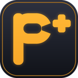

<h1 align="center">P+ Modding Tool</h1>

Mods, stats and frame data for <b>Project+</b> on <b>Brawl Online</b>, in one app. 
No typing commands, no manual file juggling: everything is a button.

<b><a href="../../releases/latest">⬇ Download the latest version</a></b> (Windows 10/11)

---

## What it does

### 🎨 Mods
- Add **costumes (skins), stages, music and texture packs** from a file, or browse and install them from the built-in **Mod Store** (GameBanana) with one click.
- **Your own music:** drop in MP3 or WAV files and they become songs the game plays. Name them, choose where they loop, set the volume, listen first, then add them to any stage's songs or replace a P+ song.
- Turn any mod on or off at any time, keep and manage profiles, and put P+'s originals back with one click.
- **Already modding the old way?** The app finds mods you put on your SD card by hand (costumes, stages, music, menus, and any files that change gameplay), shows them, and leaves them alone. If you put one of its mods in the same spot, it asks first and keeps yours: turning its mod off brings yours back.
- **Other builds too:** point it at any Dolphin with P+ or a build made from P+ (like Cobalt Smash, even in its own folder on the SD card) and it works there: mods, costume slots, frame data, and the mods already on that card show up as changed since the first time it looked.
- **Your own Dolphin too (even without Brawl Online):** make or test mods in your own P+ Dolphin? In Settings, pick its folder and the app puts mods on that Dolphin's SD card instead (with its own mods list; it can bring your mods over, turned off). One click goes back to Brawl Online's card.
- Costumes are **checked to fit in the game's memory**: one that would crash the match (usually a port with huge pictures) gets lighter pictures automatically (the model is never touched), and the original is kept.
- Every stage is **checked so you stay in sync online**. Anything that could break online play is refused before it touches your SD card.

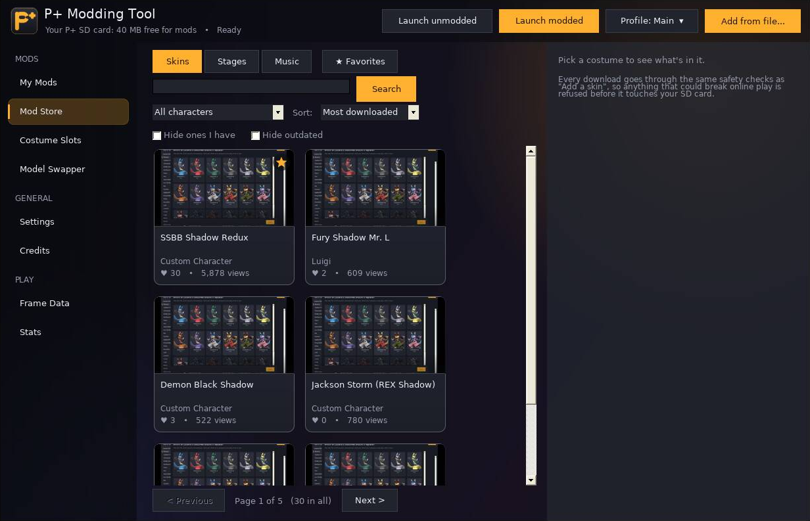
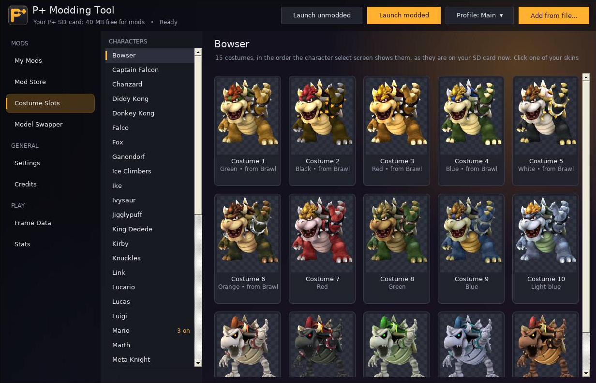

### 🧍 Model Swapper (beta)
Put a 3D model from another game or a 3D program (.glb, .gltf, .obj, .dae) on a P+ character. It keeps P+'s own skeleton and animations, so hits stay the same for both players.

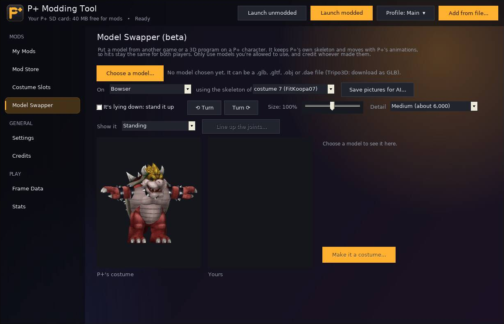

### 📊 Stat Tracker & in-game overlay
- **After every game**: a report card slides in over the game. Your **grade** (S to D) and score, the **XP** you earned filling your level bar and your character's, **badges** you just earned and **personal bests** you just set, and your best combo.
- **Coach's notes** after every game: for each stock you lost to a hit, **how to DI it** (an arrow shows where to hold the stick, and whether that would have saved you), a fun fact about how you played, and a **combo idea** from the move you open with most.
- **Progress**: your level, a mastery level for every character, your grades lately, every badge (feats like *Comeback Kid*, *Zero to Death* and *Gatekeeper*, and milestones from Bronze to Platinum) and your personal bests.
- **Overview**: your form over your last games, and your **Smash stats** as tiles with trends: openings per kill, damage per opening, neutral wins, average kill and death percent. Your **habits**: tech rate (in place, in, away, missed), how you get off the ledge, L-cancel rate, wavedashes, shields, rolls and dodges, grab success. And *what opponents could read on you*.
- **Characters**: every fighter you play on one chart (your mains, hidden gems and the ones you're still learning), each with its own stats, the moves you land and kill with, and its best and worst matchups.
- **Matches**: a simple list of your games. Click one for its full report: grade, XP, badges, how it compares with your usual, your best combo, your habits in it, the percents over the game, and every stock taken and lost (and with what).
- **Opponent scouting**: what a player tends to do, from your games against them ("techs away 60% of the time", "rolls in", "shields a lot"), each with what to do about it. On the Opponents view and on the overlay before your match.
- Your records by **matchup, stage and opponent**, and your **chance to win** before a match starts, with counterpick and stage suggestions.
- **Live Match** (a red recording dot while a game is on): everything the app reads live from the game: who you're playing, characters, stage, set score, every stock taken and lost on a timeline, ping, jitter and rollbacks, your chance to win, how each game ended, and a running list of what happened.
- A see-through **overlay** on the game (top right, away from Brawl Online's chat; or top left): a small card with your opponent, your chance and your record against them (click it for everything), the after-game report right under it, smooth fade-ins, and **themes** (seasonal by default: Halloween bats and pumpkins in October, Christmas snow and lights in December; or Midnight blue, Neon, Clean white, or your own color), a live **KO count** that flashes when a stock goes, and a hotkey for the full view.
- Everything is read from Brawl Online's own game history and replays (read only, never changed).

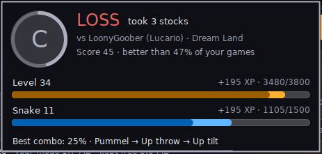

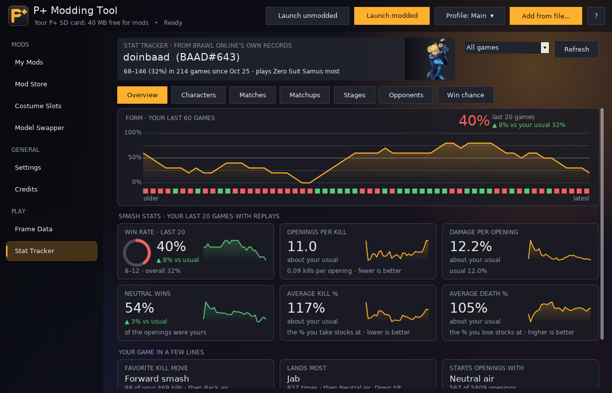
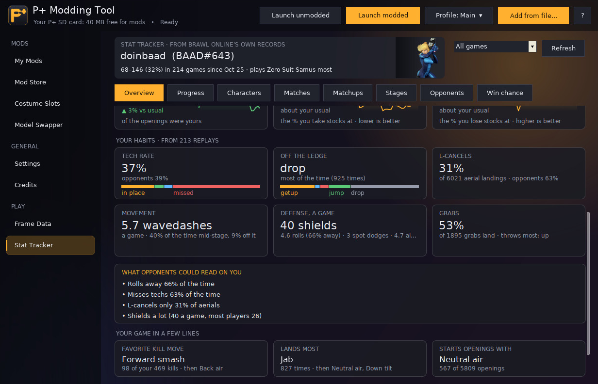
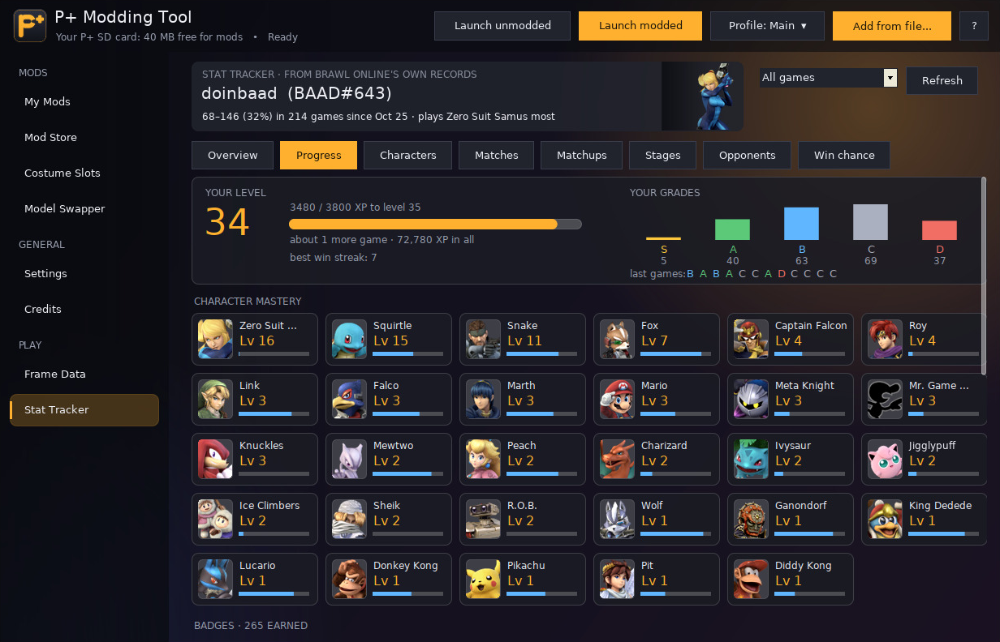
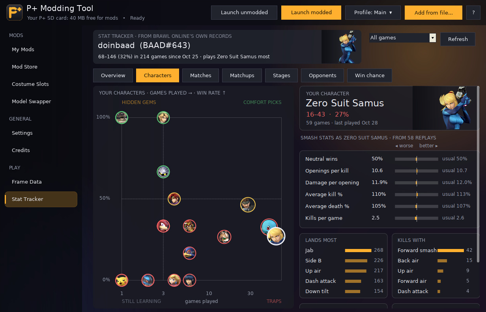
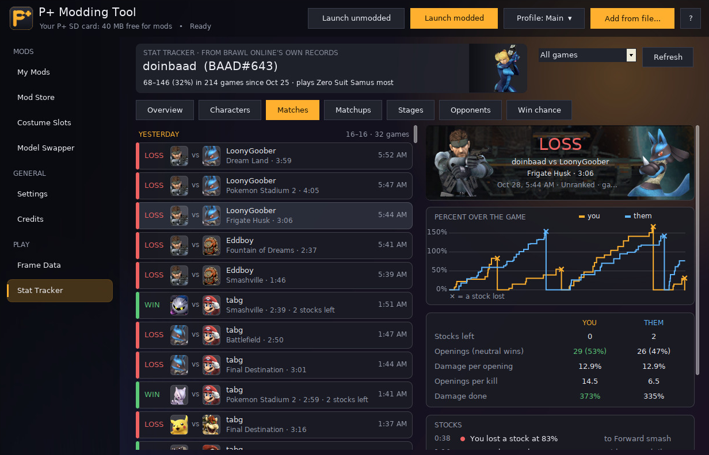

### 🎯 Frame Data
Like a frame data site, for the **whole P+ cast**, read straight from P+'s own files:
- Every move played **frame by frame** with its **hitboxes and hurtboxes**: startup, active frames, first actionable frame, landing lag (and L-cancelled), damage, angle, knockback, shield damage.
- **Projectiles** and spawned hitboxes (lasers, arrows, Fox's side B...), throws, dodges and ledge options.
- **Launch & combos**: where a hit sends your opponent at any percent and DI, hitstun, frame advantage on hit and on shield, and a chart of the **true combos** each move leads into at every percent.
- **How to DI**: drag your fighter onto the move as it plays. It picks out the hitbox that would hit you there, shows where it sends you, and draws the stick: which way to hold to **survive**, which way to **get out of combos**, and how to **SDI**. With the percent each DI kills you at.
- Save any move as a **GIF**.

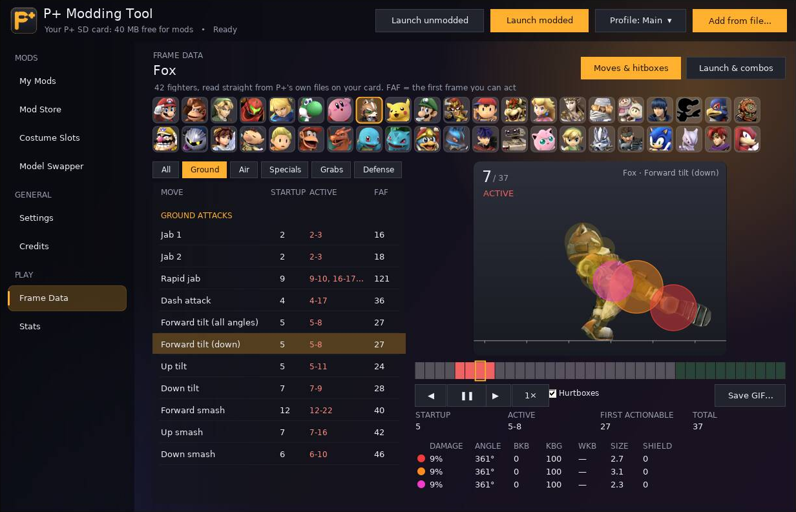
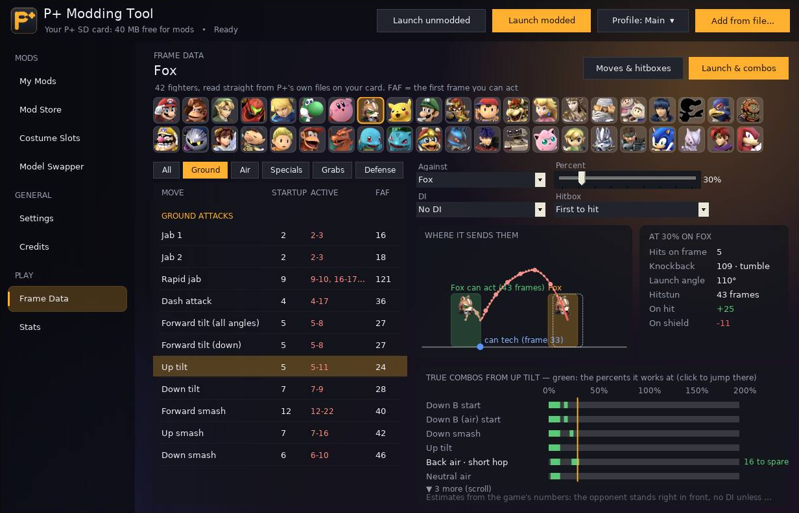
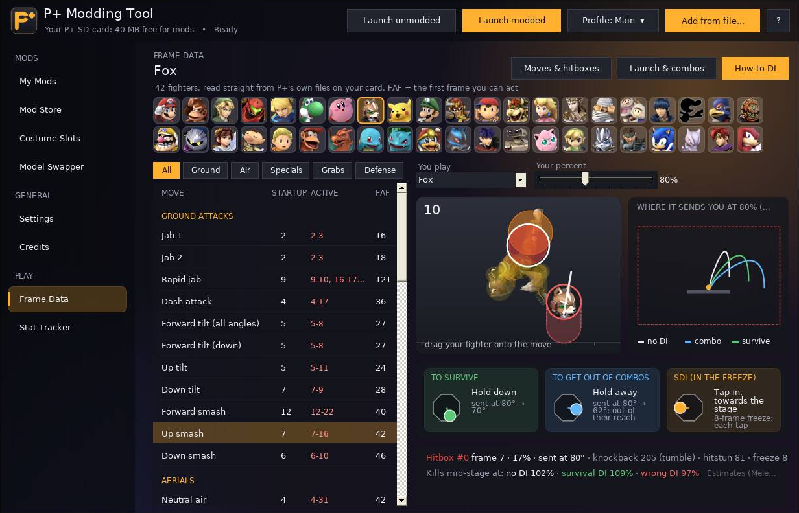

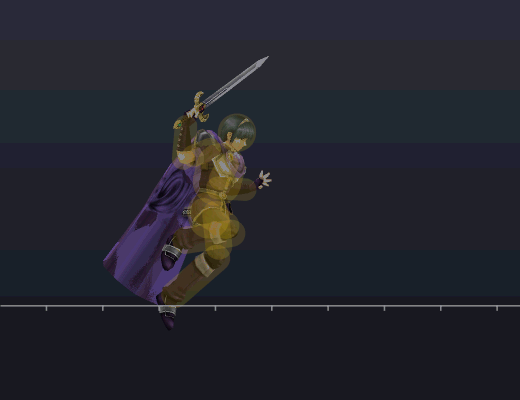

## Requirements
- Windows 10 or 11
- Brawl Online installed, with Project+ set up

## Install
1. Download **PPlusModdingTool-Setup-x.y.z.exe** from [Releases](../../releases/latest) and open it.
2. If Windows says *"Windows protected your PC"*: click **More info**, then **Run anyway** (the app isn't signed with a paid certificate).
3. Open the app. It finds Brawl Online by itself.

The app updates itself: when a new version is out, a bar appears with an **Update now** button.
Your mods, downloads and backups of P+'s own files stay in the `Data` folder next to the app.

## Is it safe to use online?
Yes. The app only changes what you choose on your own SD card image, keeps a backup of every original file, and
checks every stage before it's added so you stay in sync with other players. Stats only *read* Brawl Online's game
history; the overlay never touches the game.

## Found a bug?
In the app: **Settings → Your files → Report a problem**, or **Report it** when something goes wrong. It fills in a GitHub issue for you (the app's version, your Windows and P+ versions and the last errors it noted; your Windows user name is left out); you just press Submit. Or copy it and paste it on Discord.

## Notes
- Frame data and combo numbers come from P+'s own files; the combo chart is an estimate (shown on the page: no DI unless chosen, the opponent right in front, aerials landed and L-cancelled).
- DI advice and kill percents are estimates with the Melee rules P+ follows (DI turns a launch up to 18°), hit in the middle of a Battlefield-sized stage.
- Habits (techs, ledge options, rolls, L-cancels, wavedashes...) are read from each replay's moves and positions; grades compare a game with your own usual, so they mean "how you played for you".
- Smash stats are worked out from each replay's percents and stocks: a hit is credited to the move the other player was doing at that moment, so projectiles and items show up as "other".
- A few hitboxes are made by the game's code rather than its move files and can't be shown yet.

## Credits
Made by **Last Zodiac**. Built on the work of the Project+ team, Brawl Online, [BrawlLib / BrawlCrate](https://github.com/soopercool101/BrawlCrate) (LGPL-3.0), [OpenTK](https://opentk.net) (MIT), [NLayer](https://github.com/naudio/NLayer) (MIT) and [GameBanana](https://gamebanana.com), where every mod belongs to its creator.

Building from source: see [build/README.md](build/README.md).

## License
Copyright © 2026 Last Zodiac.

P+ Modding Tool is free software under the **GNU General Public License v3.0** ([LICENSE](LICENSE)): you can use, study, change and share it,
but anything you release that's built on it must keep the credit and be released under the GPL-3.0 too, with its full source.

The name "P+ Modding Tool" and its logo identify this project. If you publish your own changed version, please give it a different name and logo.

Libraries it uses keep their own licenses: BrawlLib (LGPL-3.0), OpenTK (MIT), NLayer (MIT, in `SkinManager.Core/ThirdParty/NLayer`). See `LICENSES` in the app's folder.
